<h1 align="center">🏝️ PixelCookie's Little Island</h1>

<p align="center">
  <b>An interactive low-poly 3D island that works as a personal website.</b><br>
  Each landmark opens a page of the notebook: writing, projects, about, travel and contact.<br>
  Built with Next.js, React and three.js, drawn with hand-inked outlines.
</p>

<p align="center">
  <a href="https://www.pixelcookie.me"><b>🌐 Visit the island → www.pixelcookie.me</b></a>
</p>

<p align="center">
  <a href="https://nextjs.org"></a>
  <a href="https://react.dev"></a>
  <a href="https://threejs.org"></a>
  <a href="https://www.typescriptlang.org"></a>
  <a href="https://tailwindcss.com"></a>
  <a href="https://vercel.com"></a>
</p>

<p align="center">
  <a href="https://www.pixelcookie.me">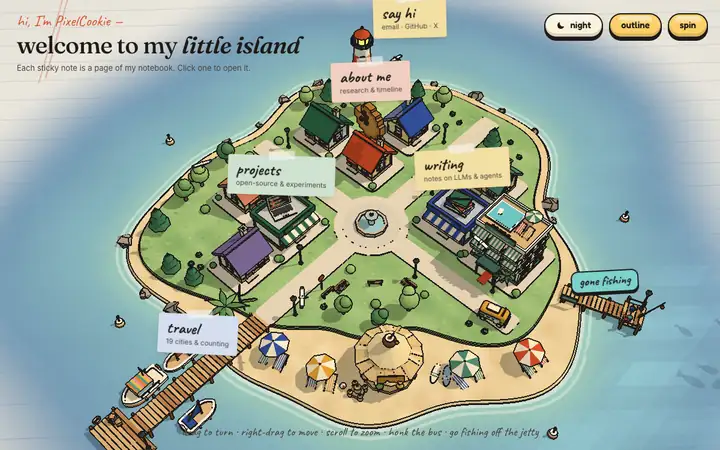</a>
</p>

<p align="center">
  <a href="#-explore-the-island">Explore</a> ·
  <a href="#-screenshots">Screenshots</a> ·
  <a href="#-features">Features</a> ·
  <a href="#-how-it-works">How it works</a> ·
  <a href="#-run-it-locally">Run it locally</a> ·
  <a href="#-中文简介">中文简介</a>
</p>

---

## 🧭 Explore the island

Instead of a scrolling page, the homepage is a small town on an island. Click (or tap) a sticky note and
the camera glides over while a jelly-style pop-up opens. Every pop-up has its own link, so you can share a single page.

| Landmark | Opens | Direct link |
| --- | --- | --- |
| 📚 Writing shop | Latest notes on LLMs and AI agents | [`/#writing`](https://www.pixelcookie.me/#writing) |
| 💻 Projects shop | Featured and open-source projects | [`/#projects`](https://www.pixelcookie.me/#projects) |
| 🍪 House with the floating cookie | About me, skills and a timeline | [`/#about`](https://www.pixelcookie.me/#about) |
| ⚓ Pier and signpost | A low-poly travel globe of visited cities | [`/#travel`](https://www.pixelcookie.me/#travel) |
| 🗼 Lighthouse | A letter-style contact card | [`/#contact`](https://www.pixelcookie.me/#contact) |
| 🎣 Jetty by the hotel | A fishing mini-game | [`/#fishing`](https://www.pixelcookie.me/#fishing) |

There are also smaller things to find: a bus that does laps and honks when clicked, sailing boats bobbing on the waves, gulls, and a lighthouse beam that sweeps brighter at night.

## 📸 Screenshots

<table>
  <tr>
    <td width="50%">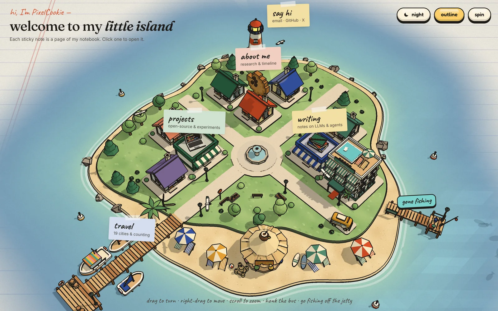</td>
    <td width="50%">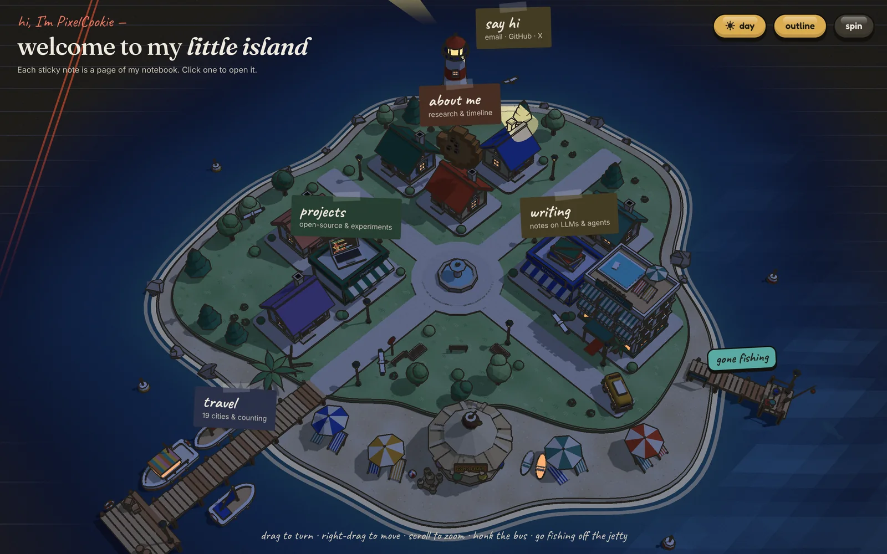</td>
  </tr>
  <tr>
    <td align="center"><b>Day</b>: paper grain, ink outlines and sticky notes</td>
    <td align="center"><b>Night</b>: follows the site's dark theme; windows and lamps light up</td>
  </tr>
  <tr>
    <td>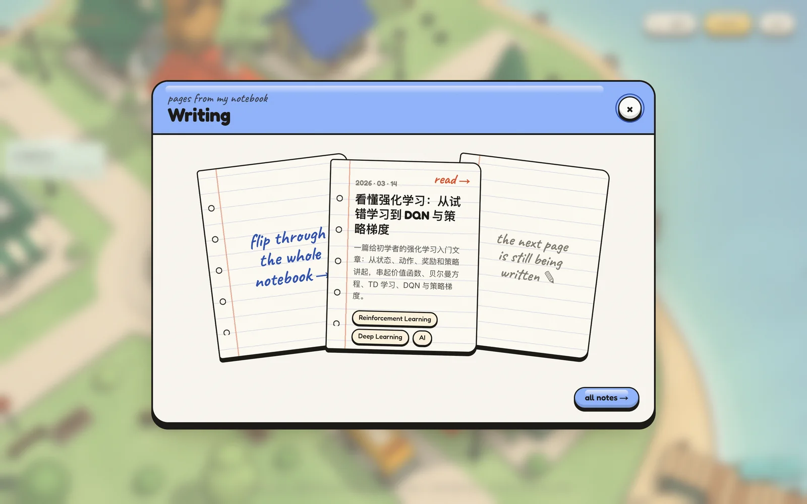</td>
    <td>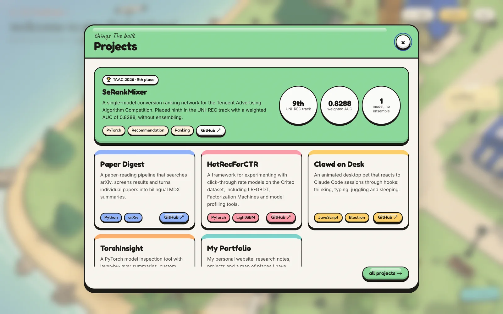</td>
  </tr>
  <tr>
    <td align="center"><b>Writing</b>: the latest post as a notebook page</td>
    <td align="center"><b>Projects</b>: a featured project with stats, then the rest</td>
  </tr>
  <tr>
    <td>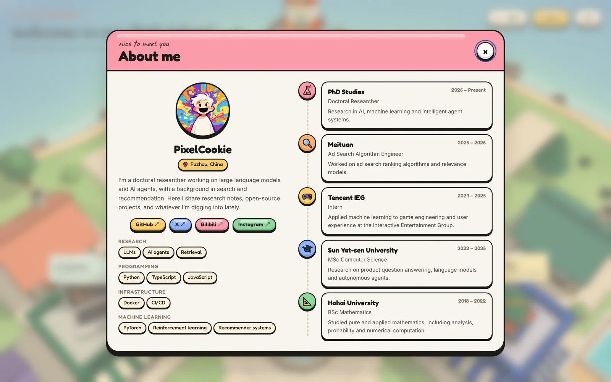</td>
    <td>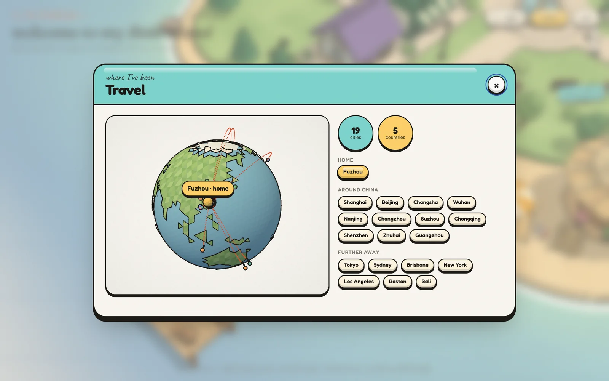</td>
  </tr>
  <tr>
    <td align="center"><b>About</b>: profile, skills and a timeline with drawn stickers</td>
    <td align="center"><b>Travel</b>: a draggable low-poly globe with a paper plane flying the routes</td>
  </tr>
  <tr>
    <td>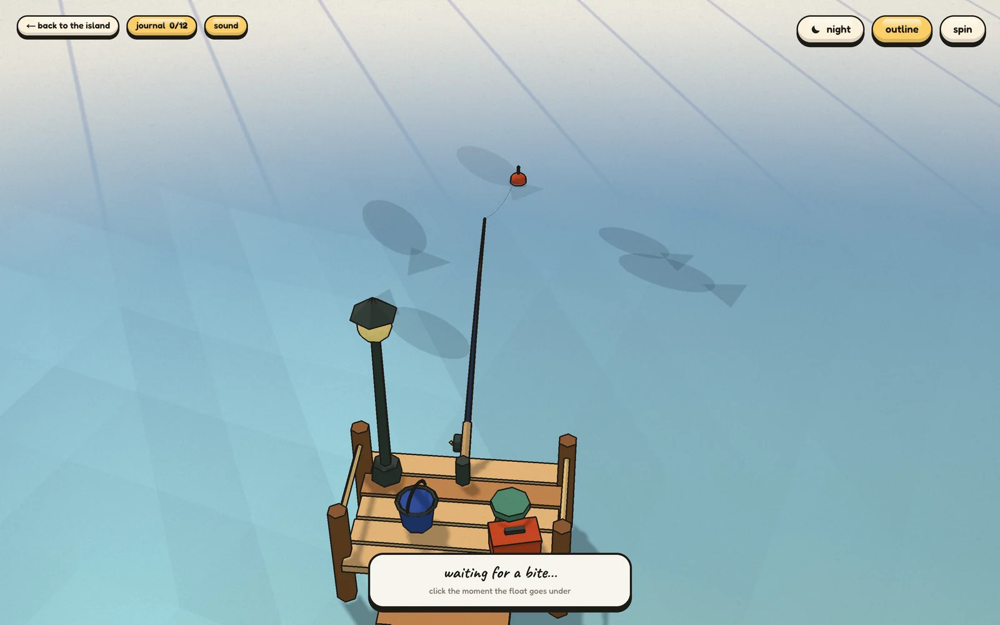</td>
    <td>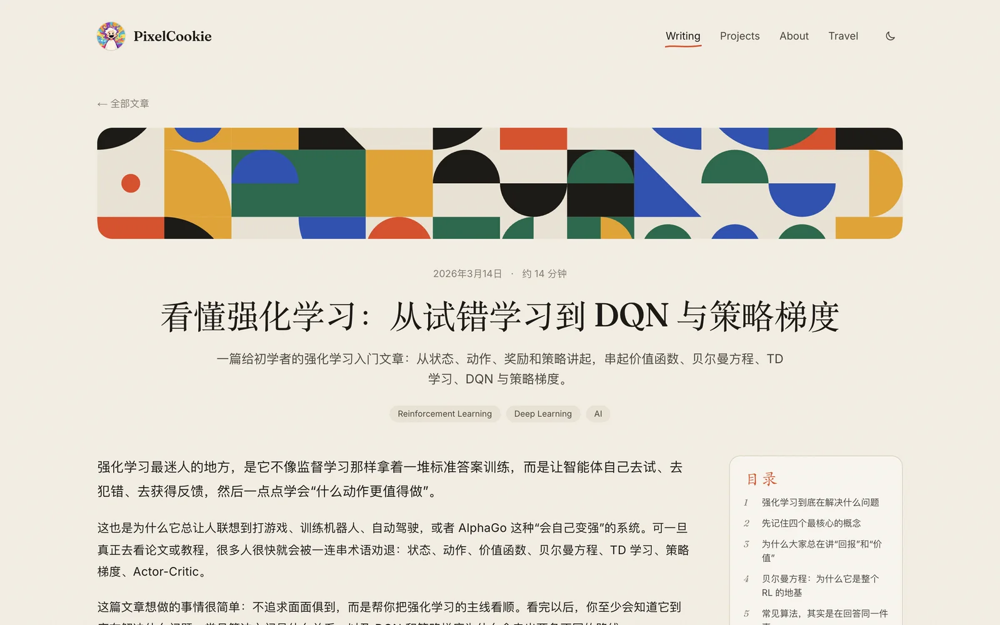</td>
  </tr>
  <tr>
    <td align="center"><b>Fishing</b>: cast, wait for the bite, strike and reel in</td>
    <td align="center"><b>Blog</b>: MDX articles with maths, a table of contents and comments</td>
  </tr>
</table>

<p align="center">
  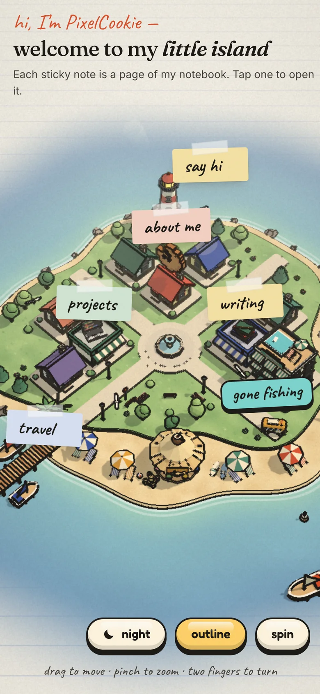
  &nbsp;&nbsp;
  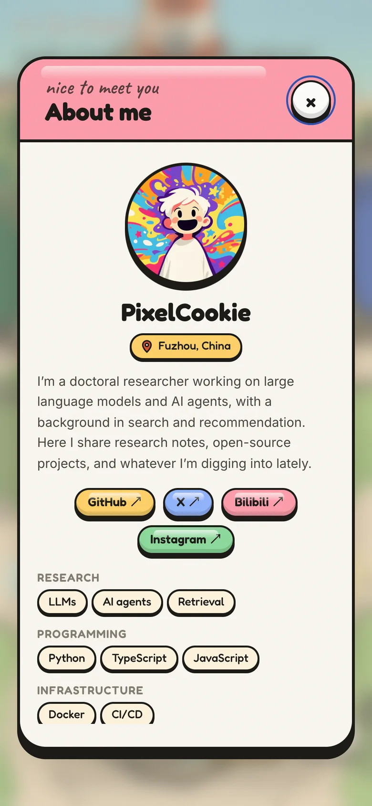
  <br>
  <sub><b>On phones</b> the island handles like a map: drag to move, pinch to zoom, two fingers to turn.</sub>
</p>

## ✨ Features

**The island**
- A hand-built low-poly town in [three.js](https://threejs.org): houses, shops, a hotel, a beach bar, boats, palms and a pier, all made from code (no 3D model files).
- A custom **ink-outline post-process** that finds edges from depth and normals, then adds paper grain and a soft vignette, so the 3D scene looks drawn in a notebook. You can turn the outline off with a button.
- **Day / night** synced with the site theme: the sea, sky and light change, windows and street lamps glow, and the lighthouse beam brightens.
- Sticky-note labels are real links that slide along the screen edge instead of being cut off, and lift their building on hover.
- **Deep links** for every pop-up (`/#about`, `/#travel`, ...) and the fishing game (`/#fishing`).
- Mouse controls (drag to turn, right-drag to move, scroll to zoom) and map-style touch controls on phones.

**The fishing game** 🎣
- Hold to charge a cast and aim with the mouse, a finger or the arrow keys. Cast farther out for rarer fish.
- Wait for the float to dip, strike in time, then reel while keeping the line tension out of the red.
- **12 catches** across four rarities, each with its own drawn card. One fish only comes out at night, and a message in a bottle carries a random blog post.
- A fishing journal saved in your browser, with small synthesised sound effects (they can be muted).

**The rest of the site**
- MDX blog with GitHub-flavoured Markdown, KaTeX maths, heading anchors, a sticky table of contents, a reading progress bar and [giscus](https://giscus.app) comments.
- Generated geometric covers for posts and projects, so no cover images are needed.
- A pencil-sketch fox mascot from [page-mascot](https://github.com/nilbuild/page-mascot).

**Performance**
- The static town is merged into a few dozen draw calls, and the render loop only runs while the island is on screen.
- three.js and the island code are loaded on demand, behind a lightweight "unfolding the map…" poster.
- Self-hosted variable fonts, so neither the build nor the page depends on Google Fonts.

## 🔧 How it works

| Layer | Tech |
| --- | --- |
| Framework | [Next.js 16](https://nextjs.org) (App Router, static generation), [React 19](https://react.dev), TypeScript |
| 3D | [three.js](https://threejs.org) with a custom WebGL post-processing pass |
| Globe data | [world-atlas](https://github.com/topojson/world-atlas) + [topojson-client](https://github.com/topojson/topojson-client) |
| Styling | [Tailwind CSS 4](https://tailwindcss.com) and plain scoped CSS for the island |
| Content | MDX via [next-mdx-remote](https://github.com/hashicorp/next-mdx-remote), [remark-gfm](https://github.com/remarkjs/remark-gfm), [KaTeX](https://katex.org) |
| Theme | [next-themes](https://github.com/pacocoursey/next-themes) |
| Hosting | [Vercel](https://vercel.com) with Vercel Analytics |

The island engine is plain JavaScript modules under [`src/components/island/engine`](src/components/island/engine):

| Module | What it does |
| --- | --- |
| [`mount.js`](src/components/island/engine/mount.js) | Renderer, camera and controls, picking, camera glides, labels and the render loop |
| [`world.js`](src/components/island/engine/world.js) | Lays out the island: coastline, water and waves, town, beach, boats, bus route and gulls |
| [`models.js`](src/components/island/engine/models.js) | The low-poly models, built from boxes, cylinders and extruded shapes |
| [`outline.js`](src/components/island/engine/outline.js) | The ink-outline and paper-grain post-process |
| [`merge.js`](src/components/island/engine/merge.js) | Merges static meshes by material to keep draw calls low |
| [`textures.js`](src/components/island/engine/textures.js) | Canvas-drawn textures: grass, sand, stripes, signs and ruled paper |
| [`ui.js`](src/components/island/engine/ui.js) | The jelly pop-ups and their contents |
| [`globe.js`](src/components/island/engine/globe.js) | The travel globe |
| [`fishing.js`](src/components/island/engine/fishing.js) | The fishing game |

[`IslandHome.tsx`](src/components/island/IslandHome.tsx) is the React wrapper: it loads the engine, passes in the site data and keeps the theme and URL hash in sync.

<details>
<summary><b>Project structure</b></summary>

```text
src/
├── app/                    # Next.js routes: /, /blog, /blog/[slug], /projects
│   ├── fonts/              # self-hosted variable fonts (OFL)
│   ├── layout.tsx
│   └── globals.css         # colour tokens, paper texture, article typography
├── components/
│   ├── island/             # the 3D homepage (IslandHome.tsx, island.css, engine/)
│   ├── blog/               # table of contents, giscus comments
│   ├── layout/             # header, footer, page shell
│   └── ui/                 # covers, doodles, reading progress, mascot
├── content/blog/           # MDX articles
├── data/                   # personal info, projects, experience, skills, travel
└── lib/                    # blog loading, headings, formatting
.github/screenshots/        # images used in this README
```

</details>

## 🚀 Run it locally

Requires Node.js 20 or later.

```sh
git clone https://github.com/PixelCookie-zyf/my-portfolio.git
cd my-portfolio
npm install
npm run dev        # http://localhost:3000
```

Other scripts:

```sh
npm run lint       # ESLint
npm test           # Node test runner
npm run build      # production build
npm run start      # serve the production build
```

### Make it yours

Most of the content lives in plain data files:

| File | Content |
| --- | --- |
| [`src/data/personal.ts`](src/data/personal.ts) | Name, bio, avatar, email and social links |
| [`src/data/projects.ts`](src/data/projects.ts) | Projects; the first one is featured in the pop-up |
| [`src/data/experience.ts`](src/data/experience.ts) | Education and work timeline |
| [`src/data/skills.ts`](src/data/skills.ts) | Skill groups |
| [`src/data/travel.ts`](src/data/travel.ts) | Visited cities for the globe (mark one as `current`) |
| [`src/content/blog/*.mdx`](src/content/blog) | Articles, with title, date, description and tags in the frontmatter |

## 📖 中文简介

这是我的个人网站 [www.pixelcookie.me](https://www.pixelcookie.me) 的源码。首页是一座可以拖动、缩放、旋转的 **低多边形（low-poly）3D 小岛**，用 three.js 搭建，并通过自定义后处理画出手绘描边和纸张质感。

- 岛上每个地标对应网站的一个栏目：文章、项目、关于我、旅行地球仪和联系方式，点击便签即可打开对应的弹窗。
- 支持日间 / 夜间模式，夜晚窗户和路灯会亮起。
- 码头上有一个钓鱼小游戏：蓄力抛竿、等待咬钩、收线，可收集 12 种鱼和杂物，图鉴保存在浏览器里。
- 博客基于 MDX，支持数学公式、目录和评论，主要记录大语言模型（LLM）与 AI Agent 方面的研究笔记。

技术栈：Next.js 16 · React 19 · three.js · TypeScript · Tailwind CSS 4，部署在 Vercel。欢迎 Star ⭐ 或参考它做一个属于自己的 3D 个人主页。

## 🙏 Credits

- Fox mascot sprites from [nilbuild/page-mascot](https://github.com/nilbuild/page-mascot) (MIT), see [`public/mascots`](public/mascots).
- Fonts: [Inter](https://github.com/rsms/inter), [Fraunces](https://github.com/undercasetype/Fraunces), [Caveat](https://github.com/googlefonts/caveat) and [Fredoka](https://github.com/hafontia/Fredoka-One), all under the SIL Open Font License, see [`src/app/fonts`](src/app/fonts).
- Coastlines from [Natural Earth](https://www.naturalearthdata.com) via [world-atlas](https://github.com/topojson/world-atlas).

## 📄 License

This is a personal project. You're welcome to read the code and learn from it, but please don't republish the personal content (writing, profile, avatar or other imagery) as your own.

<p align="center"><sub>If you enjoyed the island, a ⭐ helps other people find it.</sub></p>
